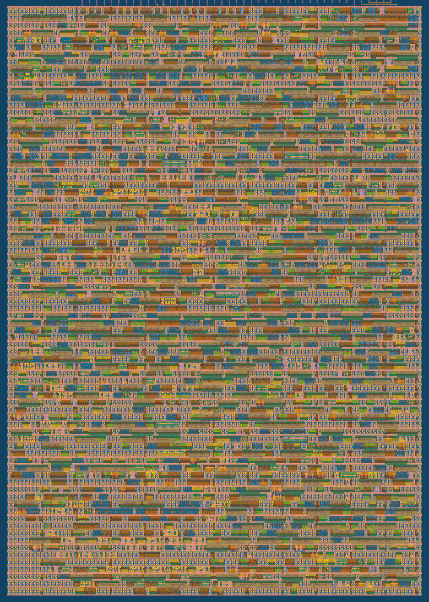

  
Computer Engineering student at the University of Utah, with experience in digital design &amp; verification.

  
Looking for a hardware or digital design internship for Summer 2027.

  <ul class="links">
    <li><a href="/assets/resume.pdf" target="_blank" rel="noopener">Resume</a></li>
    <li><a href="https://github.com/Colbywonn" target="_blank" rel="noopener">GitHub</a></li>
    <li><a href="https://www.linkedin.com/in/Colbywonn" target="_blank" rel="noopener">LinkedIn</a></li>
    <li><a href="mailto:&#99;&#111;&#108;&#98;&#121;&#106;&#109;&#105;&#108;&#108;&#101;&#114;&#43;&#69;&#67;&#69;&#64;&#103;&#109;&#97;&#105;&#108;&#46;&#99;&#111;&#109;">Email</a></li>
  </ul>

## About Me

Hello there!

My name is Colby, and I’m a second-year student at the University of Utah. I’ve always loved computers, but during the lockdown of COVID, I became truly passionate about them. I wanted to build my own PC, and so I started learning about them more and more.

At first I learned everything I could about individual PC components so I could build better, more cost-effective PCs. That led me to learn about the architectural choices that made some parts better than others. I knew that PCs ran on "ones and zeroes" but I never really understood what that meant. When I first started university, I was introduced to digital logic. I find it difficult to put into words just how astounding I found it. I still can't fathom how anyone figured out even the most basic logic optimization techniques. Digital logic is probably the most important math since calculus, and I decided that I wanted to, somehow, be a part of that legacy.

After taking a two-year break from school to serve a religious mission, I decided it was time to start learning and building for myself. I started learning Verilog so I could begin to understand how computers really work. I spent the summer building my first tapeout, which I call [Poly-Synth](/projects/synth/). While researching and building Poly-Synth, I came to an important realization: I want to design computer chips. Taking a project from no experience in RTL all the way to an ASIC was exhilarating. My goal is to architect, design, and verify the efficient, powerful VLSI chips that the future of computation requires.

There’s still a lot to learn! HDLBits and AI can only take me so far. This website is a portfolio of what I’ve learned so far and how I’ve applied it to projects that I found interesting. I hope that as my portfolio keeps expanding, so can my prowess as a chip architect. I intend to keep this website an honest representation of the processes I used and the reasoning behind my architectural decisions. I truly love this stuff. Please feel free to poke around a bit!

  Tools
  <ul>
    <li>Verilog</li>
    <li>Icarus Verilog</li>
    <li>Yosys &amp; nextpnr</li>
    <li>iCEBreaker FPGA</li>
    <li>Tiny Tapeout</li>
  </ul>

## Projects

  
  

    <h3><a href="/projects/synth/">Poly-Synth</a></h3>
    
A 3-voice polyphonic synthesizer ASIC built from three DDS cores, a mixer, and a sigma-delta output.

    
Taped out on Tiny Tapeout SKY26c, silicon pending

  

<a href="/projects/upcoming/">In progress: a RISC-V graphing calculator CPU and a redstone cell library for Yosys &#8594;</a>

