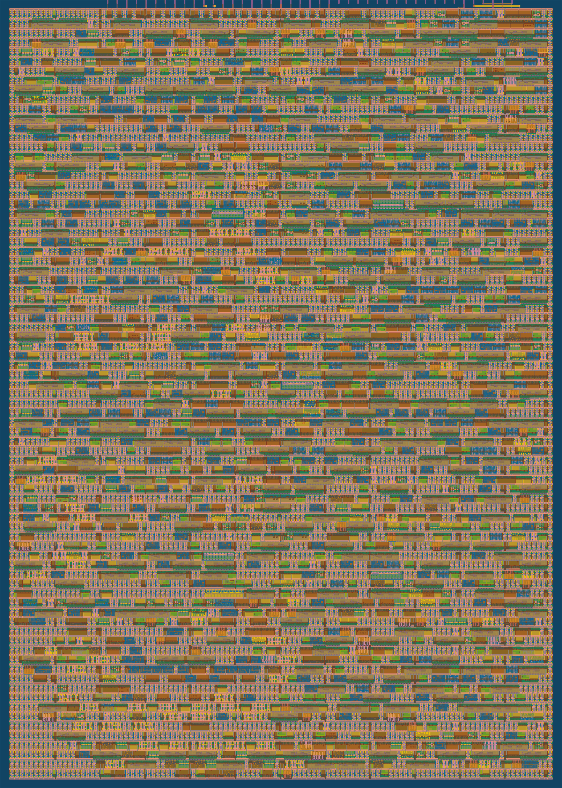

# Projects

This page exists for when I have more projects. For now, it's a stepping stone between my homepage and the Poly-Synth project page. Eventually, this page will have projects spanning many fields and ideas in computer science and electrical/computer engineering.

  
  

    <h3><a href="/projects/synth/">Poly-Synth</a></h3>
    
A 3-voice polyphonic synthesizer ASIC built from three DDS cores, a mixer, and a sigma-delta output.

    
Taped out on Tiny Tapeout SKY26c, silicon pending

  

