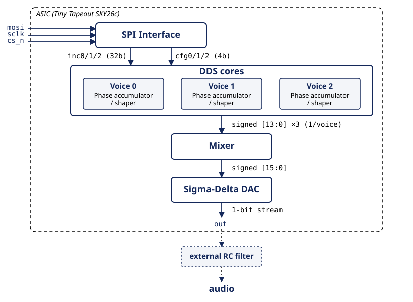
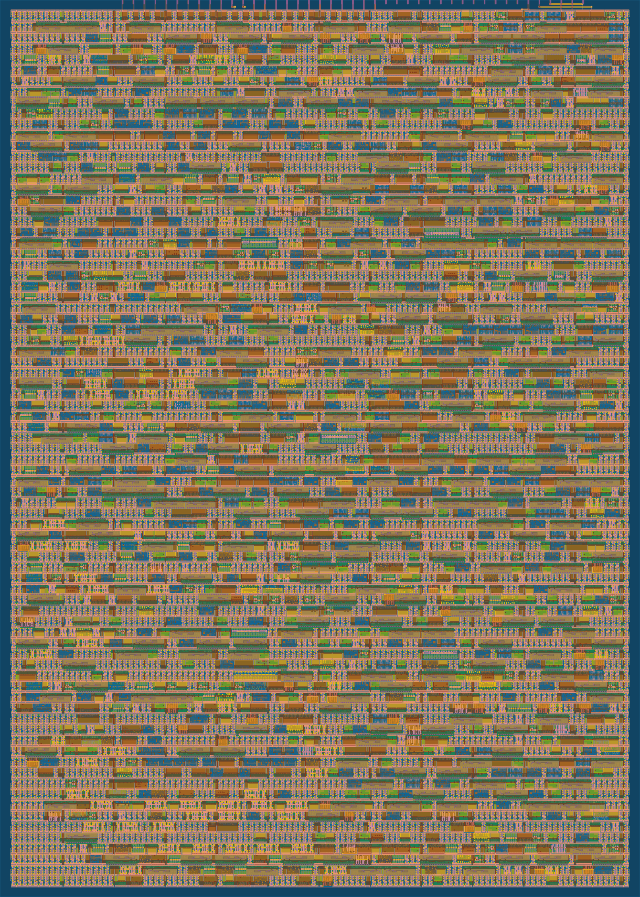

# Poly-Synth

Taped out on Tiny Tapeout SKY26c, silicon pending

<ul class="links">
  <li><a href="https://github.com/Colbywonn/tt-poly-synth" target="_blank" rel="noopener">Repository on GitHub</a></li>
  <li><a href="https://tinytapeout.com/chips/ttsky26c/tt_um_colbywonn_poly_synth/" target="_blank" rel="noopener">Tiny Tapeout project page</a></li>
</ul>

Poly-Synth is my first ASIC, written in Verilog. It's a 3-voice polyphonic synthesizer. It takes a tuning word from a source (such as a computer), passes it through one of its 3 DDS cores, and converts it into an analog signal using a 1st-order sigma-delta DAC.

I chose to build a synthesizer because of an experience I had in my Circuits I lab, where I used a headphone cable to listen to various wave frequencies generated from my Analog Discovery 2. I was interested in figuring out the methods used to turn digital signals into analog ones, and analyzing sound waves seems the easiest parallel to grasp to me.

My target was to have the chip fit reasonably into a Tiny Tapeout submission, partly because it would give me solid engineering constraints. I had to decide which features I wanted baked into my chip, and which I wanted to handle outside the chip. Tasks such as SPI master and volume control were handed off to microcontrollers and potentiometers to save valuable surface area on the chip.

## Listen to it here!

Video game (or "Chiptune") music lends itself very well to the architecture of Poly-Synth. It creates the same waveforms that the sound chips in old video game consoles like the NES did, although they diverge greatly in their architecture. While testing Poly-Synth on an FPGA, I decided to see how well it could handle some of the songs from old video games. Using a program that converts MIDI files into the needed tuning words, I bit-banged them to the synthesizer. These recordings actually came from the FPGA, and are rather good replications of the original songs.

Poly-Synth v1.0 has some limitations that its inspirations overcame, such as noise channels for percussion and more notes at once. With time, I plan to build up Poly-Synth so its capabilities are more akin to that of early synthesizers.

### "Overworld" from *The Legend of Zelda*

An arrangement of the theme composed by Koji Kondo.

<audio controls preload="none" src="/assets/audio/overworld.mp3"></audio>

### "Vampire Killer" from *Castlevania*

An arrangement of the theme composed by Kinuyo Yamashita and Satoe Terashima for the original game.

<audio controls preload="none" src="/assets/audio/vampire-killer.mp3"></audio>

## System

This diagram shows what's actually going on inside the chip. The system starts with an SPI peripheral, which is set to operate in mode 0. The interface stores the config settings and the tuning words, which are both sent in on MOSI, sequentially as needed. Those are then sent to the proper DDS core, where the tuning word drives a phase accumulator, making a sawtooth wave at whichever frequency described by the word. It is then shaped into a square (with PWM selection), sawtooth, or triangle wave depending on the configuration state currently held by the core. The 3 cores are then summed by a mixer, before being encoded by a 1st-order sigma-delta, to be recreated as an analog signal by a filter off-chip.

This right here is the die render of the ASIC. Honestly I'm still learning how to interpret things like this, but it sure looks cool :P

## Verification

Verification-wise, I tested each module of my RTL against a golden-model test bench. I identified the desired behavior of the circuit, designed a function to replicate the behavior, and tested that function against the actual behavior of the module.

When a test came back off, I went into my RTL and GTKWave to correct behavior. (AI was very handy for this, please see [that section](#how-i-used-ai) for more on how I used AI for this project). This helped me catch errors, such as incorrectly handling reset values, or forgetting to initialize values on startup, so they always held x in GTKWave.

When my test benches came back passing, I would mutation test my RTL, to prove that my tests would catch errors when there were actual errors in my code.

Another step was to run the entire chip off of the post-layout gate-level netlist. This was mostly handled by AI, as the focus of this project was RTL and not programming simulations.

Lastly, I ran the RTL on an iCEBreaker FPGA, and checked the behavior by playing songs through it (see above).

## How I used AI

This project was kinda a 0-60 for me. I have been interested in digital logic and binary for a decade. I remember making binary tables in Excel after my dad taught me about binary. In my first year of University, I had the opportunity to work in a formal verification lab and learn the basics of digital optimization and logic. I wanted to figure out for myself how we can turn gates into usable ASICs and ideas that make people's lives easier.

With the advent of Generative AI, access to knowledge has been accelerated, but also has made us lazier. With this project, I felt that dynamic sharply. While AI could help me learn things I never heard of before, it could also lull me into a sense of complacency and I let it make decisions for me.

For this project, I wanted to start building my own foundation in Verilog. I began working in HDLBits to help me learn some of the basics.

I then used AI to help me understand the exact architecture that would be needed, and it taught me the exact things that would be required to spec out my vague idea of "make a synth".

Applying that architecture to what I learned of RTL, I would write my own modules and ask AI for correction. Sometimes I learned a lot from those corrections, other times it did a lot of the work for me.

Almost every line of Verilog was written by me. AI would tell me the issues, but it wouldn't correct them for me, kind of like a mentor.

My goal isn't to be an AI prompt engineer. It is to deeply understand architecture and the decisions engineers make to create better chips. AI is one of the greatest tools ever for learning. A taped-out ASIC as a first project is an amazing example of how AI has changed the learning process in even the past 2 years. This project would not have been possible without the help of AI, at least at my current state of knowledge.

As I continue building projects and designing, I want to include AI less and less in the design process, while retaining a deep understanding on how to utilize its strengths effectively in learning and innovating.

## Status and next steps

I'm waiting for the shuttle to return from the fab still, so it'll be a while before this project is officially an ASIC.

I want to keep iterating on this project, and I have targets for future versions and the features I want them to have. Some big ones are noise channels (as mentioned earlier) and ADSR envelopes.

If I were to do this project again, I would definitely work on some of the math behind the sizes of the busses. I unfortunately had to compromise and fit the chip on 2 tiles of Tiny Tapeout, and I would love to reduce it to 1. I'm sure it could have been possible, had I optimized the bus widths a bit more. I also realized during testing that a square wave at 25% duty and 75% duty sound exactly the same. I would probably do away with one option or the other in v2.0.
